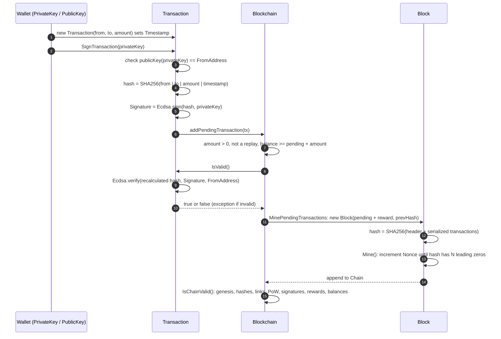

# CloudCoin

[](https://github.com/mikedsosa/CloudCoin/actions/workflows/ci.yml)

A small C# blockchain that uses **ECDSA digital signatures** to prove who authorized a transaction and **SHA-256 hash links** to make edits to past blocks detectable. It includes a security review of its original code, the fixes that came out of that review, and tests that prove each fix.

> **Educational project.** CloudCoin started as 2021 coursework. The assignment was to *"create your own blockchain and have a (mostly) functional cryptocurrency."* It runs in memory as a single process and is not a real currency. See [Remaining limitations](#remaining-limitations).

## The problem

Any shared ledger has to answer two questions:

1. **Authenticity:** did the owner of the funds actually authorize this transfer?
2. **Tamper evidence:** if someone changes a past record, will we notice?

CloudCoin answers the first with public-key signatures and the second with a chain of hashes, where every block commits to its own contents and to the hash of the block before it.

## How it works

| File | Class | Role |
| --- | --- | --- |
| [`Transaction.cs`](Transaction.cs) | `Transaction` | Sender and recipient public keys, amount, timestamp, ECDSA signature. Hashes, serializes, signs and verifies itself. |
| [`Block.cs`](Block.cs) | `Block` | Index, timestamp, transactions, previous hash, nonce and its own hash. Does proof-of-work mining. |
| [`Blockchain.cs`](Blockchain.cs) | `Blockchain` | Holds the chain and the pending transactions. Enforces transaction rules, mines blocks, checks balances, validates the chain. |
| [`Program.cs`](Program.cs) | `Program` | Demo: creates two wallets, mines, sends a signed transfer, prints the chain and checks it. |
| [`tests/CloudCoin.Tests/SecurityFixTests.cs`](tests/CloudCoin.Tests/SecurityFixTests.cs) | `SecurityFixTests` | xUnit tests for each security fix. |

### Keys and wallets

ECDSA comes from the [`starkbank-ecdsa`](https://github.com/starkbank/ecdsa-dotnet) library (`EllipticCurve` namespace), which uses the **secp256k1** curve by default. A wallet is simply a `PublicKey`. `new PrivateKey()` generates a random key pair in memory, and `privateKey.publicKey()` derives the address. Addresses are compared by their hex-encoded DER form (`Transaction.AddressToHex`).

### Signing (`Transaction.SignTransaction`)

1. Refuse to sign unless the signing key's public key matches `FromAddress`.
2. Calculate the transaction hash: SHA-256 over `from | to | amount | timestamp`. Addresses are hex DER, and the amount is formatted culture-invariantly so that `10` and `10.0` hash the same.
3. `Ecdsa.sign(txHash, signingKey)` signs that hash, and the result is stored in `Signature`.

### Verification (`Transaction.IsValid`)

A missing signature throws an exception. If a signature is present, the hash is recalculated and checked with `Ecdsa.verify(hash, Signature, FromAddress)`. Changing the sender, recipient, amount or timestamp produces a different hash, so verification fails. Mining-reward transactions (`FromAddress == null`) have no signature. `Blockchain` enforces the rules for them instead (see below).

### Accepting a transaction (`Blockchain.addPendingTransaction`)

A transaction is rejected if any of these is true:

- the sender or recipient is missing
- the amount is zero or negative
- the signature is invalid
- the same signed transaction is already in the chain or the pending pool (replay)
- the sender's confirmed balance doesn't cover this amount plus everything they already have pending

### Hashing, mining and chain validation

- `Block.CalculateHash` returns SHA-256 over `index | previousHash | timestamp | transactions | nonce`. The transactions part is the deterministic `Transaction.Serialize()` output of every transaction, covering from, to, amount, timestamp and signature.
- `Block.Mine(difficulty)` keeps incrementing `Nonce` until the hash starts with `difficulty` zero hex digits. This is a toy proof-of-work. The demo uses a difficulty of 3.
- `Blockchain.MinePendingTransactions(rewardWallet)` adds a reward transaction (`MiningReward`, 100 in the demo), mines a block that links to the latest block's hash, appends it and clears the pending list.
- The genesis block has a fixed timestamp, so it is deterministic.
- `Blockchain.IsChainValid` checks the following:
  1. **Genesis:** the genesis block matches `CreateGenesisBlock()` exactly.
  2. **For every later block:**
     - its index is correct
     - its stored hash matches a freshly calculated hash
     - its `PreviousHash` equals the previous block's hash
     - its hash meets the proof-of-work difficulty
  3. **For every transaction:**
     - the amount is positive
     - each non-reward transaction has a valid signature, isn't a duplicate, and doesn't spend more than the sender held at that point
     - a block has at most one reward, for exactly `MiningReward` and unsigned

### Sign-and-verify flow



## Build, run and test

You need the [.NET 8 SDK](https://dotnet.microsoft.com/download/dotnet/8.0). The project targets `net8.0` and uses `starkbank-ecdsa` 1.3.3 and `Newtonsoft.Json` 13.0.4.

```bash
git clone https://github.com/mikedsosa/CloudCoin.git
cd CloudCoin
dotnet run --project CloudCoin.csproj   # run the demo
dotnet test CloudCoin.sln               # run the test suite
```

**Tested setup:** I verified these steps in October 2026 on Debian 13 (x86_64) with .NET SDK 8.0.426. The build had 0 warnings and 0 errors, and `dotnet test` passed 19 of 19 tests. GitHub Actions ([`.github/workflows/ci.yml`](.github/workflows/ci.yml)) runs the same build and tests on every push and pull request to `master`.

The demo mines a reward to wallet 1, sends 10 from wallet 1 to wallet 2 and mines again with wallet 2 as the miner. It then prints the balances (`wallet1` 90, `wallet2` 110), dumps the whole chain as indented JSON and prints `Blockchain is valid`. Keys, timestamps, nonces and hashes are different on every run.

## Security review and fixes

I reviewed the original 2021 code ([`d9a5757`](https://github.com/mikedsosa/CloudCoin/tree/d9a5757421e9ac0ad665bf34b59c891399b70264)) and fixed the following issues. Every row has at least one test in [`tests/CloudCoin.Tests/SecurityFixTests.cs`](tests/CloudCoin.Tests/SecurityFixTests.cs).

| Issue | Before | After | Commit | Tests |
| --- | --- | --- | --- | --- |
| **Block hash ignored transactions** | `Block.CalculateHash` concatenated `Transactions.ToString()`, which is only the type name (``List`1[CloudCoin.Transaction]``). Changing a mined transaction's amount left `IsChainValid()` returning `true`. | The block hash covers a deterministic serialization of every transaction (from, to, amount, timestamp, signature). | [`b470297`](https://github.com/mikedsosa/CloudCoin/commit/b470297d1de78b778f292c03e7419f694d1bbfb3) | `Regression_TamperingWithMinedAmount_MakesChainInvalid`, `BlockHash_ChangesWhenAnyTransactionFieldChanges`, `TransactionSerialization_IsScaleIndependentForAmounts` |
| **Chain validation skipped signatures** | `IsChainValid` checked only hashes and links, so a re-mined block with a forged or altered transaction passed. | Every stored non-reward transaction's signature is re-verified. | [`3262ad5`](https://github.com/mikedsosa/CloudCoin/commit/3262ad5a797d0fb9f2ee571455d0669b3e3fd474) | `ForgedSignature_InLinkedAndMinedBlock_MakesChainInvalid`, `TamperedAmount_ThenRemined_IsStillCaughtBySignatureCheck`, `UnsignedNonRewardTransaction_MakesChainInvalid` |
| **No proof-of-work check** | A block with a consistent hash but no mining work was accepted. | Every block's hash must meet `Difficulty`. | [`3262ad5`](https://github.com/mikedsosa/CloudCoin/commit/3262ad5a797d0fb9f2ee571455d0669b3e3fd474) | `BlockWithoutProofOfWork_MakesChainInvalid` |
| **Genesis not checked** | The genesis block had a `DateTime.Now` timestamp and was never validated, so it could be replaced. | The genesis block is deterministic and must match `CreateGenesisBlock()`. | [`3262ad5`](https://github.com/mikedsosa/CloudCoin/commit/3262ad5a797d0fb9f2ee571455d0669b3e3fd474) | `ReplacedGenesisBlock_MakesChainInvalid` |
| **Reward transactions trusted** | Any transaction with a `null` sender was valid, for any amount. | At most one reward per block, for exactly `MiningReward`. | [`3262ad5`](https://github.com/mikedsosa/CloudCoin/commit/3262ad5a797d0fb9f2ee571455d0669b3e3fd474) | `InflatedMiningReward_MakesChainInvalid`, `TwoRewardsInOneBlock_MakesChainInvalid` |
| **Zero or negative amounts** | Accepted. | Rejected when added and when the chain is validated. | [`3262ad5`](https://github.com/mikedsosa/CloudCoin/commit/3262ad5a797d0fb9f2ee571455d0669b3e3fd474) | `NonPositiveAmount_IsRejected` (0 and -5) |
| **Pending double-spend** | The balance check ignored other pending transactions, so a wallet could queue more than it held. Mined overspends weren't detected. | Pending spends count against the balance, and `IsChainValid` replays balances and rejects overspends. | [`3262ad5`](https://github.com/mikedsosa/CloudCoin/commit/3262ad5a797d0fb9f2ee571455d0669b3e3fd474) | `PendingTransactions_CannotExceedBalance`, `MinedOverspend_MakesChainInvalid` |
| **No replay protection** | Signed data was only from, to and amount, so an identical signed transaction could be submitted again. | Transactions carry a signed timestamp. A transaction whose hash is already in the chain or the pending pool is rejected, and `IsChainValid` rejects duplicates. | [`b470297`](https://github.com/mikedsosa/CloudCoin/commit/b470297d1de78b778f292c03e7419f694d1bbfb3), [`3262ad5`](https://github.com/mikedsosa/CloudCoin/commit/3262ad5a797d0fb9f2ee571455d0669b3e3fd474) | `ReplayOfMinedTransaction_IsRejected`, `DuplicatePendingTransaction_IsRejected`, `ReplayedTransactionInLaterBlock_MakesChainInvalid` |
| **Vulnerable, end-of-life dependencies** | `netcoreapp3.1` (end-of-life). `starkbank-ecdsa` 1.3.0 was affected by [CVE-2021-43569](https://github.com/advisories/GHSA-j3jw-j2j8-2wv9) and `Newtonsoft.Json` 12.0.3 by [CVE-2024-21907](https://github.com/advisories/GHSA-5crp-9r3c-p9vr). | `net8.0`, `starkbank-ecdsa` 1.3.3, `Newtonsoft.Json` 13.0.4. The build has no warnings. | [`1f073fe`](https://github.com/mikedsosa/CloudCoin/commit/1f073fe3f01a14296ef79fa5335ded12299f0dd8) | Whole suite |

The tests were added in [`8db87f2`](https://github.com/mikedsosa/CloudCoin/commit/8db87f25cdbf2f99d9e856f9af4875a5139d6f7c). As a check, I temporarily put the old `Transactions.ToString()` hashing back. The regression test and the block-hash test both failed (2 of 19), and they passed again after the fix was restored.

## Remaining limitations

- **Single process, no network.** There's no peer-to-peer networking, consensus, fork resolution or persistence. "Valid" only means the in-memory chain is internally consistent.
- **Demo-only key handling.** Private keys are generated in memory and thrown away when the program exits. Nothing is stored, encrypted or protected.
- **Limited replay protection.** It works by rejecting exact duplicates. The timestamp is set by the sender and isn't checked for freshness, and there are no per-account nonces.
- **Toy proof-of-work.** Difficulty is a fixed, mutable setting on `Blockchain` with no adjustment, and validation uses whatever the current value is. Block timestamps aren't validated.
- **Simple hashing and scaling.** Transactions are hashed as one concatenated serialization, not a Merkle tree. Balance and replay checks rescan the whole chain, which is fine for a demo but doesn't scale.
- **Rewards identified by convention.** A reward is still recognized by its `null` sender. The rules are now enforced, but there's no coinbase structure or fees.
- **Not audited.** The fixes are covered by the tests in this repo and haven't had an independent review.

## Attribution

CloudCoin follows the design of [SavjeeCoin](https://github.com/Savjee/SavjeeCoin) by Xavier Decuyper (MIT License), the JavaScript blockchain from the *Simply Explained* tutorial series, ported to C#. The class layout (`Transaction` / `Block` / `Blockchain`), method names such as `minePendingTransactions`, `getBalanceOfAddress` and `isChainValid`, the null-sender reward transaction and several error messages match that project closely. Credit for the original design belongs to its author, and the [LICENSE](LICENSE) keeps his copyright notice.

ECDSA is provided by [starkbank-ecdsa](https://github.com/starkbank/ecdsa-dotnet) (MIT License), and JSON output by [Newtonsoft.Json](https://www.newtonsoft.com/json) (MIT License).

## Background

I wrote this in February 2021 for the blockchain unit of a college course. In 2026 I reviewed it as an applied-cryptography exercise. The review and fixes above are a security assessment of my own earlier work.

## License

[MIT](LICENSE)
