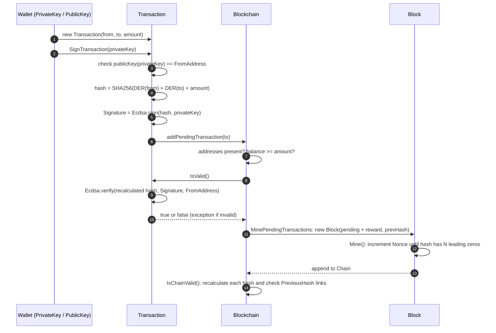

# CloudCoin

A small C# blockchain that uses **ECDSA digital signatures** to prove who authorized a transaction and **SHA-256 hash links** to make edits to past blocks detectable.

> **Educational project.** CloudCoin started as 2021 coursework. The assignment was to *"create your own blockchain and have a (mostly) functional cryptocurrency."* It runs in memory as a single process. It is not a real currency, and its code has not been hardened for production. See [Security caveats](#known-limitations-and-security-caveats).

## The problem

Any shared ledger has to answer two questions:

1. **Authenticity:** did the owner of the funds actually authorize this transfer?
2. **Tamper evidence:** if someone changes a past record, will we notice?

CloudCoin answers the first with public-key signatures and the second with a chain of hashes, where every block commits to the hash of the block before it.

## How it works

| File | Class | Role |
| --- | --- | --- |
| [`Transaction.cs`](Transaction.cs) | `Transaction` | Sender and recipient public keys, amount, ECDSA signature. Hashes, signs and verifies itself. |
| [`Block.cs`](Block.cs) | `Block` | Index, timestamp, list of transactions, previous hash, nonce and its own hash. Does proof-of-work mining. |
| [`Blockchain.cs`](Blockchain.cs) | `Blockchain` | Holds the chain and the pending transactions. Mines blocks, checks balances, validates the chain. |
| [`Program.cs`](Program.cs) | `Program` | Demo: creates two wallets, mines, sends a signed transfer, prints the chain and checks it. |

### Keys and wallets

ECDSA comes from the [`starkbank-ecdsa`](https://github.com/starkbank/ecdsa-dotnet) library (`EllipticCurve` namespace), which uses the **secp256k1** curve by default. A wallet is simply a `PublicKey`. `new PrivateKey()` generates a random key pair in memory, and `privateKey.publicKey()` derives the address. Throughout the code, addresses are compared by their DER encoding (`PublicKey.toDer()`, hex-encoded).

### Signing (`Transaction.SignTransaction`)

1. Refuse to sign unless the signing key's public key matches `FromAddress` (*"You cannot sign transactions for other wallet!"*).
2. Calculate the transaction hash: SHA-256 over `hex(DER(from)) + hex(DER(to)) + Amount`.
3. `Ecdsa.sign(txHash, signingKey)` signs that hash string, and the result is stored in `Signature`.

### Verification (`Transaction.IsValid`)

- Mining-reward transactions have `FromAddress == null` and are accepted without a signature.
- Otherwise a missing signature throws an exception. If a signature is present, the hash is recalculated and checked with `Ecdsa.verify(hash, Signature, FromAddress)`. Changing the sender, recipient or amount produces a different hash, so verification fails.

`Blockchain.addPendingTransaction` runs this check before it accepts a transaction. It also requires both addresses and checks that the sender's confirmed balance covers the amount.

### Hashing, mining and chain validation

- `Block.CalculateHash` returns SHA-256 over `Index + PreviousHash + Timestamp + Transactions + Nonce`.
- `Block.Mine(difficulty)` keeps incrementing `Nonce` until the hash starts with `difficulty` zero hex digits. This is a toy proof-of-work. The demo uses a difficulty of 3.
- `Blockchain.MinePendingTransactions(rewardWallet)` adds a reward transaction (`MiningReward`, 100 in the demo), mines a block that links to the latest block's hash, appends it and clears the pending list.
- `Blockchain.IsChainValid` walks the chain from block 1 onward and checks that:
  1. each block's stored `Hash` matches a freshly calculated hash, and
  2. each block's `PreviousHash` equals the previous block's `Hash`.

`GetBalanceOfWallet` replays every transaction in the chain and adds or subtracts amounts for the given public key.

### Sign-and-verify flow



## Build and run

The project targets `netcoreapp3.1` and uses `Newtonsoft.Json` 12.0.3 and `starkbank-ecdsa` 1.3.0 from NuGet.

**Tested setup:** I verified these steps in October 2026 on Debian 13 (x86_64) with the .NET 8 SDK. No .NET Core 3.1 runtime was installed, so roll-forward was used.

```bash
git clone https://github.com/mikedsosa/CloudCoin.git
cd CloudCoin
dotnet build
# .NET Core 3.1 is end-of-life. If you only have a newer runtime, let the app roll forward:
DOTNET_ROLL_FORWARD=Major dotnet run
```

The build succeeds but shows warnings: the target framework is end-of-life, and both NuGet packages have known advisories (see below). On Windows you can also open `CloudCoin.sln` in Visual Studio.

### What the demo prints

`Program.cs` mines a reward to wallet 1, sends 10 from wallet 1 to wallet 2 and mines again with wallet 2 as the miner. It then prints the balances (`wallet1` 90, `wallet2` 110), dumps the whole chain as indented JSON and prints `Blockchain is valid`. Keys, timestamps, nonces and hashes are different on every run.

## What it demonstrates

- Generating secp256k1 key pairs and using a public key as an identity or address.
- Signing a transaction digest with ECDSA and verifying it against the claimed sender. A forged or altered transaction fails `IsValid()`.
- Refusing to sign with a key that doesn't own the sending address.
- Hash-linking blocks so that changing a block's header fields (index, timestamp, previous hash, nonce) or breaking a link makes `IsChainValid()` return `false`.
- A minimal proof-of-work loop and a balance model where every balance is calculated by replaying the chain.

## Known limitations and security caveats

The project is educational, so it has gaps. These are the most important ones:

- **Block hashes don't actually cover the transactions.** `Block.CalculateHash` concatenates `this.Transactions.ToString()`, and for a `List<Transaction>` that returns only the type name (``System.Collections.Generic.List`1[CloudCoin.Transaction]``), not the contents. A local experiment confirmed that changing the amount of a mined transaction still leaves `IsChainValid()` returning `true`, while that transaction's own `IsValid()` returns `false`. Fixing it would mean hashing a canonical serialization of the transactions, or a Merkle root.
- **Chain validation doesn't re-verify signatures.** `IsChainValid` checks only hashes and links. It doesn't call `Transaction.IsValid()` on stored transactions, doesn't check proof-of-work difficulty and doesn't check the genesis block.
- **No replay protection.** The signed data covers only sender, recipient and amount. There's no nonce, timestamp or transaction ID, so an identical signed transaction could be submitted again.
- **Pending double-spends are possible.** The balance check uses only confirmed blocks, so several pending transactions from one wallet can add up to more than its balance. Zero or negative amounts aren't rejected either.
- **Reward transactions are trusted by convention.** Any transaction with a `null` sender counts as valid.
- **Key handling is demo-only.** Private keys are generated in memory and thrown away when the program exits. Nothing is stored, encrypted or protected.
- **Single process, no network.** There's no peer-to-peer networking, consensus, fork resolution or persistence.
- **Outdated dependencies.** `netcoreapp3.1` is out of support. `starkbank-ecdsa` 1.3.0 is affected by [CVE-2021-43569](https://github.com/advisories/GHSA-j3jw-j2j8-2wv9) (improper signature verification, fixed in 1.3.2). `Newtonsoft.Json` 12.0.3 is affected by [CVE-2024-21907](https://github.com/advisories/GHSA-5crp-9r3c-p9vr) (fixed in 13.0.1). Don't reuse this code as-is.

## Attribution

CloudCoin follows the design of [SavjeeCoin](https://github.com/Savjee/SavjeeCoin) by Xavier Decuyper (MIT License), the JavaScript blockchain from the *Simply Explained* tutorial series, ported to C#. The class layout (`Transaction` / `Block` / `Blockchain`), method names such as `minePendingTransactions`, `getBalanceOfAddress` and `isChainValid`, the null-sender reward transaction and several error messages match that project closely. Credit for the original design belongs to its author.

ECDSA is provided by [starkbank-ecdsa](https://github.com/starkbank/ecdsa-dotnet) (MIT License), and JSON output by [Newtonsoft.Json](https://www.newtonsoft.com/json) (MIT License).

## Background

I wrote this in February 2021 for the blockchain unit of a college course. It's kept here as an applied-cryptography example, and the code is unchanged from the original submission. The caveats above are a security review of my own earlier work.
